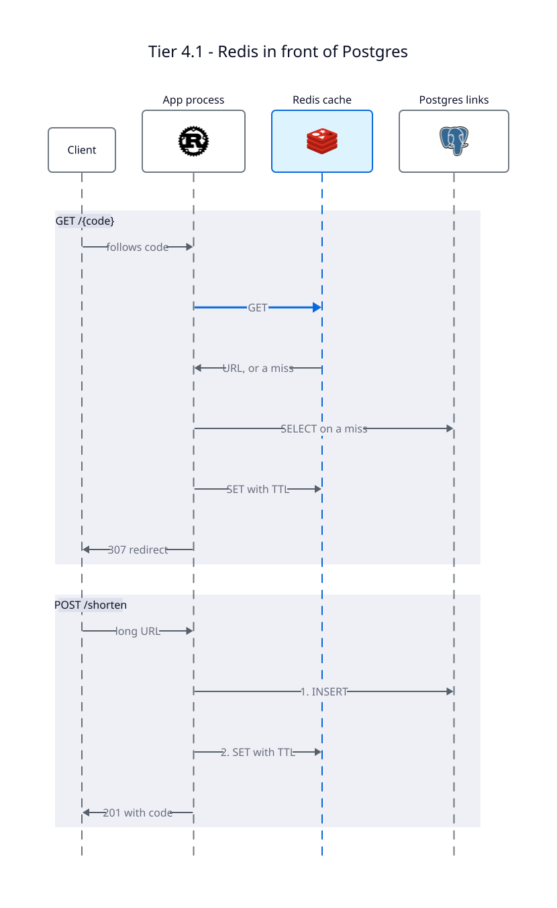

# Tier 4.1 — Caching with Redis: Cache-Aside

**Problem being solved:** Tier 3 fixed durability, but now every redirect, about 99%
of traffic, costs a database query. This tier puts Redis in front of Postgres so most
redirects never reach the database.

Redis is **Tier 1's hash table, moved onto the network and shared between processes**:
`GET` and `SET` are `HashMap::get` and `insert` over a wire. It keeps its data in its
own memory, so it's fast, and it runs as a separate process, so it can fail on its own.

---

## The whole design

This is called **cache-aside**, or look-aside: the app talks to both Redis and Postgres,
and Redis never talks to the database.

| Operation | What happens |
|---|---|
| `GET /{code}` | `GET` from Redis. On a miss, `SELECT` from Postgres, then `SET` with a TTL. |
| `POST /shorten` | `INSERT` into Postgres. The cache fills on the first read. |
| `PATCH` or `DELETE /{code}` | Write to Postgres, then `DEL` the key from Redis. |

Three rules hold it together:

1. **Postgres is the truth, and Redis only holds copies.** Postgres is always written
   first, so a failed write can't leave Redis with a URL the database never had.
2. **Writes delete the cached value instead of updating it.** A delete can be repeated
   safely, and the next read fetches the current value.
3. **A broken cache costs speed, not availability.** If Redis fails, a read counts as a
   miss and asks Postgres. The app reconnects by itself once Redis is back.

## The TTL: stale, but it fixes itself

Every cached value expires after **5 minutes**, and that's the design's safety net.
Whatever goes wrong, a wrong value lives for at most one TTL:

- `DEL` fails after a write: the write stays committed, and the old value expires.
- A race caches an old URL: it expires too.
- Someone edits Postgres by hand: same.

No code has to detect any of this. It's a cheap way to stay simple, and the TTL becomes
the tradeoff: a shorter one means less staleness and more Postgres queries.

AWS presents this same pairing, lazy loading plus a TTL, as the way to get the benefits of
both lazy loading and write-through. It admits the TTL can't rule out staleness, but says
"it keeps data from getting too stale"
([ElastiCache caching strategies](https://docs.aws.amazon.com/AmazonElastiCache/latest/dg/Strategies.html)).
The 5 minutes is the value its lazy-loading example uses, and every later tier keeps it.

---

## What breaks here, on purpose

| Problem | Status |
|---|---|
| **Thundering herd:** when a hot key expires, every request misses at once and all of them query Postgres. | Fixed in Tier 4.3 |
| **Stale set:** a read that started before a write can cache the old URL after the write's `DEL`. See [Race 2](../docs/race-conditions.md). A test reproduces it. | Fixed in Tier 4.3 |
| A code that was never minted costs a Postgres query on every request. | Fixed in Tier 4.2 |
| While Redis is down, the full read load lands on Postgres. | Open problem |

## Discussion questions

1. If Tier 0 accepts a stale redirect, how long is too long? Pick a TTL and defend it.
   What changes if the link is a phishing page someone just deleted?
2. Walk through the stale set in `a_slow_read_can_cache_a_stale_value`. Why doesn't
   writing to Redis before Postgres fix it?
3. Why does a `DELETE` return success when its `DEL` fails? What would the user see,
   and for how long?
4. At about 4,000 reads/s and a 95% hit rate, how many queries reach Postgres? What
   happens to that number in the first second after Redis restarts empty?

**Previous:** [Tier 3 — Persistence](../tier-3-persistence/README.md) ·
**Next:** [Tier 4.2 — Bloom Filter for the Negative Case](../tier-4.2-caching/README.md)
