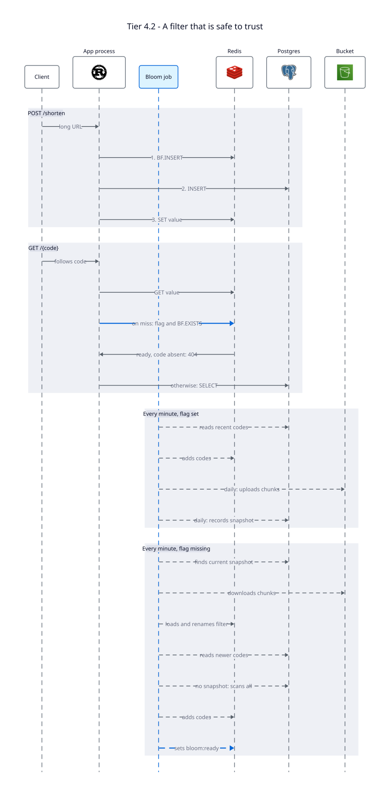

# Tier 4.2 — Caching with Redis: Bloom Filter for the Negative Case

A copy of [Tier 4.1](../tier-4.1-caching/README.md) plus a Bloom filter.

**Problem:** `resolve` for a code that was never minted still costs a full
Postgres query, every time. There's no way to cache "this doesn't exist," only
"this exists, here's the URL."

**Fix:** a RedisBloom filter of every minted code. `resolve` checks it on a cache
miss, before Postgres, and a "definitely absent" answer becomes a 404 with no
query at all.



---

## The rule that keeps it safe

A Bloom filter never gives a false negative, but only while it holds every code.
A false positive costs one wasted query. A false negative makes a real link 404,
which is exactly what Tier 0 says is unacceptable. And the filter lives in Redis,
which is otherwise treated as disposable.

So **the filter may only say "absent" if it's known to be complete.** The key
`bloom:ready` records that. `resolve` reads it and the filter together:

| `bloom:ready` | `BF.EXISTS` | `resolve` does |
|---|---|---|
| missing | ignored | Asks Postgres |
| set | 1 | Asks Postgres (could be a false positive) |
| set | 0 | Returns 404 without a query |

A flush removes the flag along with the filter, so a wiped Redis falls back to
the safe path by itself, with the app still running.

If the filter check itself fails, `resolve` treats that like a missing flag and
asks Postgres.

`resolve` also rejects anything that couldn't be a code before touching Redis.
Otherwise `GET /bloom:ready` would read the flag and redirect to it.

## Writing to the filter

`shorten` adds the code *before* the `INSERT`, the opposite order from the value
cache. A code in the filter whose `INSERT` fails is a false positive. A committed
row missing from the filter would be a false negative.

It uses `BF.INSERT ... CAPACITY n ERROR e` rather than `BF.ADD`. After a flush,
the next `shorten` recreates the filter either way, but `BF.ADD` would create it
with a capacity of 100.

## The maintenance job

A background task runs every minute. A Postgres advisory lock keeps it to one app
instance at a time.

- **Flag set:** re-adds codes from the last 5 minutes, repairing any that a Redis
  crash lost after acknowledging them. Once a day it also saves a snapshot.
- **Flag missing:** rebuilds the filter, then sets the flag.

The app starts serving immediately and fills the filter in the background, instead
of blocking on a scan at every start.

A flush could land in the middle of a rebuild, leaving a half-built filter that
must never be marked ready. So each pass creates its own `bloom:building:{id}` key
and finishes with `RENAME` to `bloom:ready`. If a flush took the marker, the
`RENAME` fails and the next run starts over.

## Snapshots

Rebuilding means reading every code from Postgres. A snapshot avoids most of that,
the same way a Raft node restores a snapshot and replays only the log after it:

1. **Save:** upload each `BF.SCANDUMP` chunk to `bloom/{id}/{iter}`, then point
   `bloom_snapshots` at it in one transaction. The bucket can't join a transaction,
   so upload order is what keeps it safe: a failed upload leaves the previous
   snapshot current, and the next save clears any leftovers.
2. **Restore:** load the chunks into a temporary key, `RENAME` it over the filter,
   then re-add codes from `taken_at` minus a margin. The temporary key matters:
   `BF.LOADCHUNK` over a filter that `shorten` already recreated loses those codes
   without an error. The margin matters because `created_at` isn't commit order,
   and re-adding a code is harmless.
3. **Fall back:** if any chunk fails to load, discard the snapshot and scan `links`.
   Only a filter marked ready is ever snapshotted.

Snapshots live in a bucket because they get big: about 1.4 GB for 1.2 billion
codes, which a database's WAL and backups shouldn't carry for data that can be
rebuilt. The app reaches it through the S3 API, and `docker-compose.yml` provides
one for local runs.

## Clearing deleted codes

A Bloom filter can't remove anything, so a rebuild is the only way to clear old
codes. It's two steps, because otherwise the job would restore the snapshot with
those codes still in it:

```sql
DELETE FROM bloom_snapshots;
```

```bash
redis-cli DEL bloom:ready codes_bloom
```

The job then scans `links`, and misses go to Postgres until it finishes.

---

## What breaks here

| Problem | Status |
|---|---|
| A link can't be edited or deleted, because nothing invalidates the cache. | Fixed in Tier 4.3 |
| No coordination on a cache-miss stampede. | Fixed in Tier 4.3 |
| While Redis is down, reads fall back to Postgres with no limit on the load, and writes return 500. | Open problem |
| A code lost in a Redis crash can 404 for up to a minute, until the job repairs it. | Accepted |

## Discussion questions

1. With the codes coming from a sequence, nearly every id below the counter
   exists. Which requests does this filter actually stop? What changes once codes
   are scrambled with Tier 2's permutation?
2. A deleted code stays in the filter and queries Postgres on every request. What
   would caching "this doesn't exist" for 60 seconds cost, and how does it fail
   compared to the filter?
3. Should `bloom:ready` be replaced by simply having the job build a new filter
   beside the old one and swap them? What does that gain during a rebuild, and what
   has to happen to writes in the meantime?

**Previous:** [Tier 4.1 — Cache-Aside](../tier-4.1-caching/README.md) ·
**Next:** [Tier 4.3 — Invalidation and a Lease](../tier-4.3-caching/README.md)
