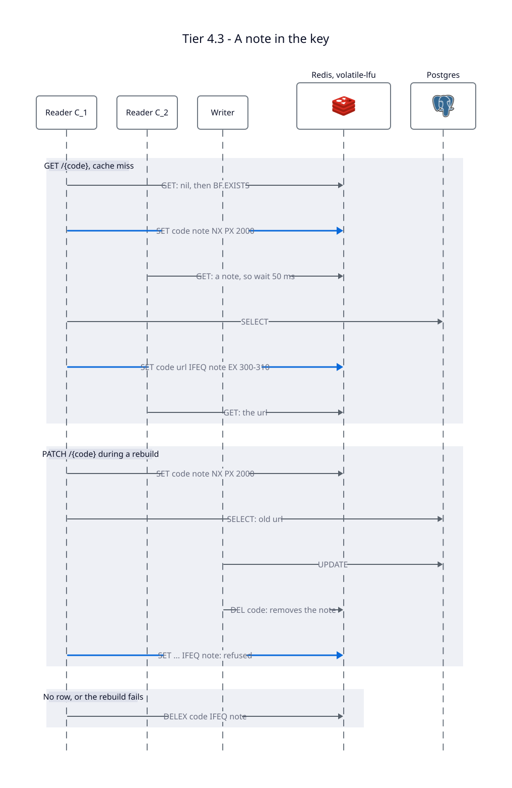

# Tier 4.3 — Caching with Redis: A Note in the Key

A copy of [Tier 4.2](../tier-4.2-caching/README.md) with a new read path and real eviction
settings. Only `src/store.rs` and `docker-compose.yml` change.

**Problem:** Tier 4.1 left two failures open on purpose:

- **Thundering herd:** a hot key expires and every request queries Postgres at once.
- **Stale set:** a slow read caches an old URL after a write's `DEL`
  ([Race 2](../docs/race-conditions.md)).

**Fix:** on a miss, the reader that rebuilds the key first leaves a **note** in it. Other
readers see the note and wait. The rebuilder only writes the URL if its note is still there.

---

## The core decision: the note lives in the cached key

A note is the value `"\0" + random hex`, stored under the code itself. No URL can start
with a NUL byte, because Postgres `TEXT` can't hold one, so readers can tell the two apart.

Putting it in the same key is what makes the design small. Writers already send `DEL code`,
and that one command now also cancels any rebuild in progress. The rebuilder's
`SET ... IFEQ note` then finds nothing to match and is refused.

This is how the reference designs do it:

| Pattern | Where the marker lives | Fixes the stale set? | Cost |
|---|---|---|---|
| **Note in the key, `SET IFEQ`** (this tier) | In the cached key | Yes | Redis 8.4. Every reader must check for the prefix. |
| Facebook's leases ([paper](https://www.usenix.org/system/files/conference/nsdi13/nsdi13-final170_update.pdf), §3.2.1) | Server-side token per key | Yes | Needs a modified memcached. |
| Memcached meta commands (`N`, `W`, `Z` flags, [docs](https://docs.memcached.org/protocols/meta/)) | Empty placeholder item in the key | Yes, with CAS | Memcached, not Redis. |
| [IdentityCache](https://github.com/Shopify/identity_cache) (Shopify) | `[FILL_LOCKED, client_id, version]` in the key | Yes, with CAS | Memcached. Deletes also write a short-lived `DELETED` marker into the key. The closest production match to this tier. |
| [rueidisaside](https://github.com/redis/rueidis/tree/main/rueidisaside) | `rueidisid:` placeholder in the key | Yes | Lua scripts, written before `IFEQ` existed. This tier is the same design without them. |
| [rockscache](https://github.com/dtm-labs/rockscache) | Hash fields `lockOwner`, `lockUntil` beside `value` | Yes, and serves stale while rebuilding | Lua for every operation. |
| Separate `lock:{code}` key, as in Redis's [cache-aside guide](https://redis.io/docs/latest/develop/use-cases/cache-aside/rust/) | A second key | **No**: a `DEL` of the value doesn't stop the rebuild | Two keys that can drift apart, and need a hash tag to share a Redis Cluster node. |
| In-process singleflight | App memory | No | Only coalesces within one process. |

So the idea is established: production caches keep the marker in the key, while most
tutorials, Redis's own included, teach a separate lock that stops stampedes but not stale
sets. What's new here is building it on `SET IFEQ`, which only arrived in Redis 8.4. We
didn't find a published library that uses it for cache fills yet.

IdentityCache's README also lists lost invalidations and cache flushes as known causes of
stale data, the same limit described under "What breaks here".

## Every Redis call

| Situation | Commands |
|---|---|
| Hit | `GET` |
| Miss, first reader | `GET` → `BF.EXISTS` → `SET code note NX PX 2000` → `SELECT` → `SET code url IFEQ note EX 300–310` |
| Miss, someone is rebuilding | `GET` every 50 ms. After 200 ms, `SELECT` without caching. |
| No row, or the `SELECT` failed | `DELEX code IFEQ note`, so readers don't wait out the note |
| `PATCH`, `DELETE` | `UPDATE` or `DELETE`, then `DEL code`. Writers never wait. |
| Redis fails | `SELECT` without caching |

Both conditional writes are single commands. `IFEQ` compares and writes atomically, so it
needs no Lua script ([SET](https://redis.io/docs/latest/commands/set/),
[DELEX](https://redis.io/docs/latest/commands/delex/)).

The note expires after 2 seconds, so a rebuilder that crashes frees the key on its own.

## TTL jitter

Every TTL is 5 minutes plus 0 to 10 random seconds. Keys cached together, say right after
a restart, then don't all expire in the same second.

The base TTL is the same as in Tiers 4.1 and 4.2. There it's the only fix for a stale
set. Here writes invalidate and `IFEQ` refuses stale fills, so it only has to catch rare
cases like a failed `DEL`. A wrong value can survive up to 310 seconds.

## Eviction

| Setting | Value | Why |
|---|---|---|
| `maxmemory` | `8mb` | Unlimited by default, so Redis would never evict. Small on purpose, to make eviction easy to watch. Size it to your hot set in production. |
| `maxmemory-policy` | `volatile-lfu` | Evicts only keys with a TTL, least used first. URLs and notes have one. The filter and `bloom:ready` don't, so they're never evicted. |

Redis suggests `allkeys-lru` for a pure cache, with data that must stay on a separate
instance ([eviction docs](https://redis.io/docs/latest/develop/reference/eviction/)).
`volatile-lfu` keeps one instance for both.

---

## What breaks here

As long as every Redis command succeeds, no order of reads and writes leaves the cache
holding an old URL. `mixed_reads_and_writes_never_leave_a_stale_value` checks this over
50 rounds; the same test fails against Tier 4.1. What's left comes from **lost
invalidations**:

| Problem | Status |
|---|---|
| **A writer's `DEL` fails** after its commit: a Redis blip, or the app crashing in between. The old URL stays cached, and a rebuild in progress can cache it again, because its note was never removed. It lasts up to one TTL, 310 s. | Fixed in Tier 4.4 |
| **Writes during a Redis outage.** Their `DEL`s fail, and with `appendonly` the old values come back when Redis does. | Fixed in Tier 4.4 |
| A reader that fetched the value just before a write's `DEL` serves the old URL once. | Inherent to any cache |
| A cached URL ignores `expires_at`, so an expired link can redirect for up to one TTL. No endpoint sets it yet. | Open problem |
| If keys without a TTL fill memory, nothing is left to evict, and writes like `BF.INSERT` fail. | Accepted |
| A rebuild slower than 200 ms lets waiters through to Postgres. | Accepted |
| A deleted code queries Postgres on every request, because the filter can't forget it. | Open problem |
| While Redis is down, the full read load lands on Postgres. | Open problem |
| Race 1 needs replicas, which we don't have yet. | Not applicable |

## Discussion questions

1. Why does the note have to start with a byte no URL can contain? What happens if a
   reader forgets the check?
2. A waiter gives up after 200 ms but the note lives 2 seconds. What does each number
   protect, and what goes wrong if you swap them?
3. Memcached's `I` flag marks a value stale instead of deleting it, and one reader
   refreshes it while the others keep serving the old URL. What would that take in Redis,
   and does Tier 0's "stale is fine" make it worth it?
4. With `volatile-lfu`, what happens to a key that's read once a minute versus one read
   1,000 times in the last second?

**Previous:** [Tier 4.2 — Bloom Filter for the Negative Case](../tier-4.2-caching/README.md) ·
**Next:** [Tier 4.4 — Invalidations from the WAL](../tier-4.4-caching/README.md)
