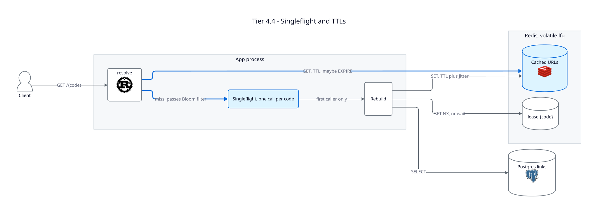

# Tier 4.4 — Caching with Redis: Invalidations from the WAL

A copy of [Tier 4.3](../tier-4.3-caching/README.md) plus a worker that reads Postgres's
write-ahead log (WAL) and sends a second `DEL` for every changed link.

**Problem:** in Tier 4.3, a writer commits, then sends `DEL`. If that `DEL` is lost to a
Redis blip, an outage or an app crash in between, the old URL stays cached for up to one
TTL. Edits made directly in `psql` are never invalidated at all.

**Fix:** **change data capture (CDC)**. Postgres already records every committed change in
its WAL. The invalidator reads that log for `links` and deletes each changed code from
Redis, retrying until Redis accepts. It's the same idea as `mcsqueal` in the
[Facebook paper](https://www.usenix.org/system/files/conference/nsdi13/nsdi13-final170_update.pdf).

---

## Two `DEL`s

| Who | When | On failure |
|---|---|---|
| The handler (`PATCH`, `DELETE`) | Right after the commit | Logs it and moves on |
| The invalidator | When it reads the commit from the WAL, usually milliseconds later | Retries every second until Redis accepts |

The handler's `DEL` keeps **read-your-writes**: a client that edits a link and follows it
right away sees the new URL. The invalidator's `DEL` makes sure the invalidation eventually
lands. Facebook ran both too: web servers invalidated their own cluster "as an
optimization", and `mcsqueal` sent every invalidation from the commit log (paper, §4.1).

Sending `DEL` twice is safe because **`DEL` is idempotent**: once or ten times, the key ends
up absent. A late `DEL` can only empty the cache, never make it wrong. The 4.3 argument
against stale sets only needs the `DEL` to come after the commit, and both do.

## How the invalidator reads the WAL

1. **`wal_level=logical`** makes Postgres log enough to rebuild row changes
   ([docker-compose.yml](docker-compose.yml)).
2. **A publication**, `links_pub`, picks the tables to stream
   ([migration](migrations/0003_cache_invalidation.sql)).
3. **A replication slot**, `cache_invalidator`, records how far the invalidator has
   confirmed. Postgres keeps the WAL from there on, across restarts of either side.
4. **The stream** arrives one committed transaction at a time, in `pgoutput` format. The
   invalidator collects the code of every update and delete, sends one `DEL` at the
   commit, and only then confirms the commit's position.

The last step is what makes it reliable: **confirm only after Redis accepted the `DEL`**.
If the invalidator crashes in between, Postgres resends the transaction, and the repeated
`DEL` is harmless. Delivery is at least once.

Only one connection can hold a slot. With several app instances, the others fail to
connect and retry every second, so the slot also works as the lock.

The [`pgwire-replication`](https://crates.io/crates/pgwire-replication) crate handles the
protocol. Decoding the two message types we need takes about 20 lines in
[`invalidator.rs`](src/invalidator.rs).

## Side effects

| Effect | Why |
|---|---|
| About one extra miss per write | A reader can rebuild the key between the two `DEL`s, and the second one removes that correct value. |
| Two `DEL`s per write | Trivial at about 40 writes/s. |
| A broken invalidator can go unnoticed | The handler's `DEL` hides it until a Redis blip happens. Watch the slot's lag: `pg_wal_lsn_diff(pg_current_wal_lsn(), confirmed_flush_lsn)` in `pg_replication_slots`. |
| The slot keeps WAL while the invalidator is down | `max_slot_wal_keep_size=1GB` caps it. Past that, Postgres drops the slot to protect its disk, those `DEL`s are lost, and the TTL is the backstop again. |

---

## What breaks here

| Problem | Status |
|---|---|
| The slot doesn't follow a Postgres failover unless it's a failover slot (Postgres 17). | Open problem: there's one Postgres here |
| A cached URL ignores `expires_at`. | Open problem, as in Tier 4.3 |
| While Redis is down, the full read load lands on Postgres. | Open problem |
| The invalidator assumes `code` is the first column of `links`. | Accepted: a `shortcut:` comment in the code |
| Race 1 needs replicas, which we don't have yet. With them, each region would run its own invalidator from its own replica, as `mcsqueal` did. | Designed in Tier 5 |

## Discussion questions

1. Remove the handler's `DEL`. What does a client that edits its own link see, and for how
   long? Is that acceptable under Tier 0?
2. Why must the invalidator confirm a position only after the `DEL` succeeds? Trace a crash
   right after a confirmation that came too early.
3. Why doesn't `shorten` move its Bloom filter add to the invalidator too?
4. What would change if the invalidator wrote the new URL with `SET` instead of `DEL`?

**Previous:** [Tier 4.3 — A Note in the Key](../tier-4.3-caching/README.md) ·
**Next:** [Tier 5 — Read Regions](../tier-5-read-regions/README.md)
