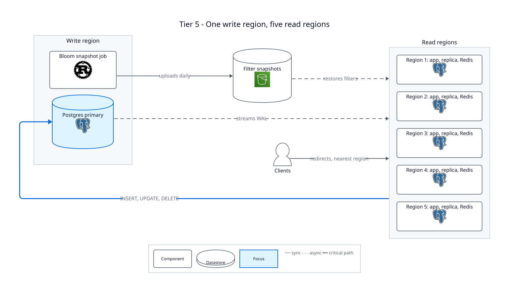
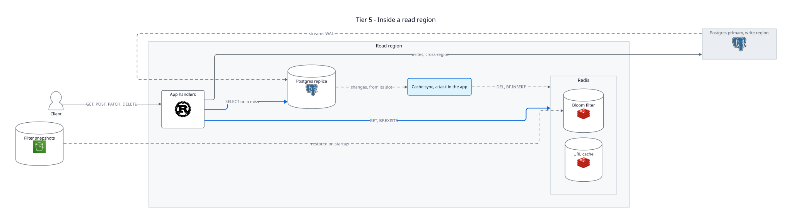
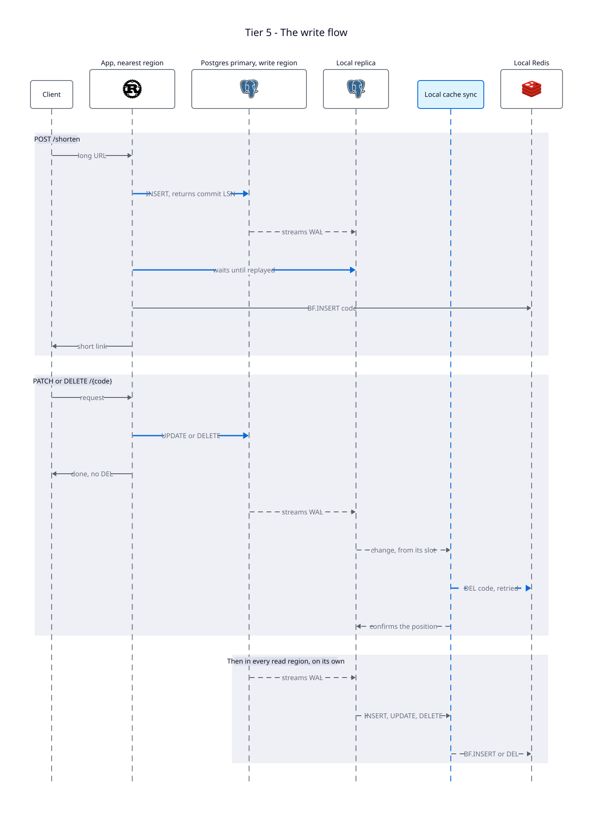

# Tier 5 — Read Regions

A design tier with no code. It takes the [Tier 4.4](../tier-4.4-caching/README.md) app to
six regions: one that takes every write, and five that serve redirects locally.

**Problem:** every request still crosses the world to one Postgres and one Redis. A client
far away pays that round trip on every redirect, and if Redis goes down, the full read load
lands on the single Postgres.

**Fix:** keep one writer, and copy it everywhere. A shortener does about 100 reads per write
(Tier 0), the shape this design is built for. OpenAI runs ChatGPT's Postgres the same way:
one primary for writes, nearly 50 read replicas across regions, a cache in front, and no
sharding ([OpenAI](https://openai.com/index/scaling-postgresql/),
[InfoQ summary](https://www.infoq.com/news/2026/02/openai-runs-chatgpt-postgres)).

---

## Who does what

| Region | Runs | Job |
|---|---|---|
| Write region | Postgres primary, the Bloom snapshot job | Takes every `INSERT`, `UPDATE` and `DELETE`. Uploads the filter snapshot, since `bloom_snapshots` lives in Postgres and only the primary can write it. |
| Each read region | The app, a Postgres replica, Redis, cache sync | Serves redirects from its own Redis and replica. Sends writes to the primary. |

Postgres copies the data by itself: each replica receives the primary's WAL and replays
it, with no code of ours involved. Our code only keeps each region's Redis in step with its
own replica.

## Cache sync

Tier 4.4's invalidator, renamed because it now does two jobs. It reads committed changes
from a slot on **its region's replica**, not on the primary:

| Change | What cache sync does |
|---|---|
| `INSERT` | `BF.INSERT code` into the region's filter |
| `UPDATE`, `DELETE` | `DEL code` from the region's cache, retried until Redis accepts |

**Why the local replica:** a change only reaches cache sync after that replica has replayed
it. So every `DEL` lands after the new value is readable in the region, and a reader that
refills the cache gets the new URL. That's the ordering 4.3 relies on, now in every region,
and it closes [Race 1](../docs/race-conditions.md). An invalidator reading the primary
could send its `DEL` before the replica caught up, and a reader would cache the old URL
again. Facebook's `mcsqueal` reads each region's local log for the same reason.

Logical decoding on a replica needs Postgres 16, `wal_level=logical` on the primary, and
`hot_standby_feedback=on` on the replica. Without the last one, the primary can clean up
rows the slot still needs, and Postgres invalidates the slot.

## The write flow

**Edits and deletes:** the handler writes to the primary and answers. It sends no `DEL`:
the local replica would still be behind, so the `DEL` couldn't give read-your-writes, and
cache sync is already the one that retries. The rule becomes: **every change reaches every
region shortly after it commits**, usually in under a second.

**New links:** the handler waits for its own region's replica before answering.

1. `INSERT` on the primary, and read the commit position with `pg_current_wal_lsn()`.
2. Check the local replica's `pg_last_wal_replay_lsn()` every few milliseconds until it
   reaches that position, with a timeout.
3. `BF.INSERT` the code into the local filter, and return the short link.

So a link always works right away in the region that created it. In other regions, cache
sync adds it to the filter when the `INSERT` arrives, and until then a redirect there
returns 404. The 404 isn't cached, so the link starts working on its own.

**Why the filter can't be corrupted:** adding a code only turns bits on, and nothing turns
them off. The filter is also never ahead of the primary, because the handler adds the code
only after the commit came back. A duplicate `BF.INSERT` from cache sync changes nothing.

## Bloom filters in every region

Each region keeps its own filter in its own Redis:

1. **On startup**, restore the latest snapshot from the bucket, which every region must be
   able to read.
2. **Catch up** by `created_at` from the local replica, as Tier 4.2 does.
3. **Stream** new codes from cache sync's slot.

**Ordering:** a new region creates its slot **before** step 2. Otherwise a code inserted
between the scan and the slot's creation never reaches its filter. Overlap between the scan
and the stream is fine.

---

## What changes for the client

| Request | Before (Tier 4.4) | Tier 5 |
|---|---|---|
| Redirect | One round trip to the only region | Served in the nearest region |
| Redirect right after an edit | New URL, while the handler's `DEL` succeeds | Old URL for replica lag plus cache sync lag |
| Redirect right after creating | Works | Works in the same region; 404 for a moment elsewhere |
| `POST /shorten` | One round trip | A cross-region round trip, plus waiting for the local replica |
| `PATCH`, `DELETE` | One round trip | A cross-region round trip |

## What breaks here

| Problem | Status |
|---|---|
| The primary is the only writer. If it fails, every region loses writes and keeps serving reads. | Open problem: a hot standby and failover slots (Postgres 17) |
| Each extra replica adds WAL streaming load on the primary. OpenAI is testing cascading replication for this. | Accepted at six regions |
| A stalled cache sync fills its replica's disk with WAL, up to `max_slot_wal_keep_size`. | Alert on slot lag in each region |
| If the local replica can't catch up before the timeout, `POST /shorten` must fail or answer anyway. | Open problem |
| A cached URL ignores `expires_at`. | Open problem, as in Tier 4.3 |
| Every region can only grow the filter. A deleted code still costs a replica query. | Open problem, as in Tier 4.2 |

## Discussion questions

1. Run cache sync from the primary's slot instead. Trace a read in a lagging region that
   caches the old URL. Why doesn't 4.3's note stop it?
2. Why does `POST /shorten` wait for the replica, but `PATCH` doesn't?
3. A region id in every code would let each region mint its own. What does that buy, given
   about 40 writes per second?
4. What would you alert on, and in which region, to catch a stalled cache sync before it
   fills a disk?

**Previous:** [Tier 4.4 — Invalidations from the WAL](../tier-4.4-caching/README.md)
